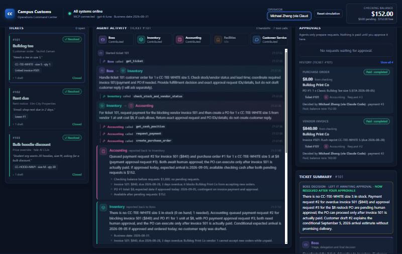

# Campus Customs: Multi-Agent Operations System

An AI operations platform for **Campus Customs**, a Yale campus apparel shop. Five AI agents work together to resolve business tickets: customer orders, rent notices and discount requests. They read and update the shop's SQLite database only through an **MCP server**. A **FastAPI backend** runs the agents, and a **React dashboard** lets a human operator watch the agents work and approve every payment.

> Yale SOM · AI Foundations for Managers · Homework 5. All agents use `gpt-6-luna` through Portkey.



---

## Contents

- [How it works](#how-it-works)
- [Repository layout](#repository-layout)
- [Installation](#installation)
- [Database setup](#database-setup)
- [Running the application](#running-the-application)
- [Testing the application](#testing-the-application)
- [Safety rules](#safety-rules)
- [Assignment deliverables](#assignment-deliverables)

---

## How it works

```
React dashboard (frontend/, Vite)          http://localhost:5173
        │  JSON over HTTP
        ▼
FastAPI backend (backend/main.py)          http://localhost:8000   ── output/audit_trail.json (append-only)
        │  one long-lived MCP connection
        ▼
Agent team (PydanticAI, gpt-6-luna via Portkey)
   Boss ⇄ Inventory ⇄ Accounting ⇄ Facilities ⇄ Customer Service
        │  MCP tool calls (each agent has its own tool allowlist)
        ▼
MCP server (mcp_server/, FastMCP, stdio)  ──SQL──▶  data/campus_customs_new.db
```

**The five agents** (`backend/prompts/`):

| Agent | Role |
|---|---|
| **Boss** | Triages tickets, delegates to specialists, makes the final decision. The only agent that changes ticket status. |
| **Inventory** | Stock by SKU and size, shortages, vendor choice, lead-time delivery dates. |
| **Accounting** | Cash, invoices, margins and discounts. *Queues* payments and purchase orders for human approval; can never pay. |
| **Facilities** | Verifies rent notices against the lease, asks Accounting to queue rent, drafts the landlord reply. |
| **Customer Service** | Writes customer reply **drafts**. Nothing is ever sent. |

**Collaboration.** Any agent can call `ask_agent` to hand a task to any other agent and get a structured report back. For example, on ticket 101 Inventory asked Accounting directly to pay a blocking vendor invoice and order a restock. Guards prevent loops: no asking yourself, no cycles, at most 3 levels deep, at most 8 delegations per ticket, repeated questions answered from a cache, and a token budget per ticket.

**MCP server** (`mcp_server/`, 19 tools). This is the only code that touches the database. It enforces the business rules itself: vendors with unpaid invoices can't take new orders, the balance can never go negative, a payment can't run twice, and customer drafts can't leak internal details. Agents only see their own allowlisted tools. The three money-moving tools are **human-only**.

**Backend.** `backend/main.py` exposes tickets, agent runs, live agent events, approvals, cash and reset. **Dashboard.** `frontend/` shows the tickets, a live feed of each agent's work, per-agent contributions, the approval queue, and the checking balance.

Full technical documentation is in [`output/harness.md`](output/harness.md), and the design rationale in [`output/design.md`](output/design.md).

---

## Repository layout

```text
├── AI_prompts.md            # prompt log for Problems 1-11
├── README.md
├── requirements.txt         # Python dependencies
├── .env.example             # environment variable template (copy to .env)
├── .mcp.json                # registers the MCP server with Claude Code
├── data/
│   ├── campus_customs.db        # ORIGINAL database (never modified; used for resets)
│   └── campus_customs_new.db    # WORKING database (all reads and writes)
├── mcp_server/              # FastMCP server: db.py, tools.py, workflow_tools.py, human_tools.py, server.py
├── backend/                 # FastAPI app, agents, orchestrator, approvals CLI, audit log
│   ├── main.py  models.py  agents.py  orchestrator.py  runtime.py  config.py  audit.py  approvals.py
│   └── prompts/             # boss.md, inventory.md, accounting.md, facilities.md, customer_service.md, shop_policies.md
├── frontend/                # React 19 + Vite + TypeScript dashboard
├── scripts/                 # rule tests, smoke-test verifier, report builders
└── output/                  # deliverables (harness, plans, results, audit trail, screenshots, GitHub URL)
```

---

## Installation

**Prerequisites:** Python 3.11+ (tested on 3.14), Node.js 20+ (tested on 24 LTS), Git, and a **Portkey API key** with access to `gpt-6-luna`.

```bash
git clone https://github.com/MichaelZ1212/campus-customs-hw5.git
cd campus-customs-hw5
```

**Python dependencies** (create a virtual environment in the project root):

```bash
python -m venv .venv
```

Then activate it:

- macOS/Linux: `source .venv/bin/activate`
- Windows (PowerShell): `.venv\Scripts\Activate.ps1`

and install the packages:

```bash
pip install -r requirements.txt
```

**Frontend dependencies:**

```bash
cd frontend
npm install
cd ..
```

**Environment variables.** Copy the template and put in your real key. `backend/config.py` loads `.env` automatically. `.env` is git-ignored, so never commit it.

```bash
cp .env.example .env    # Windows: copy .env.example .env
```

```dotenv
PORTKEY_API_KEY=your-real-portkey-key
```

Exporting `PORTKEY_API_KEY` in your shell works too, and takes precedence over `.env`. Without a key, every endpoint works except running the agents.

---

## Database setup

| File | Purpose |
|---|---|
| `data/campus_customs.db` | The original data from `data.zip`. **Never modified.** |
| `data/campus_customs_new.db` | The working copy that the MCP server reads and writes. |

**This repository ships the working database in its final state from Problem 9:** all three tickets are resolved, three payments are recorded, and checking is at $152. To run the tickets again, reset first using any one of these:

1. **Dashboard:** click **Reset simulation** in the header, then confirm.
2. **API** (backend running):
   ```bash
   curl -X POST http://localhost:8000/api/reset -H "Content-Type: application/json" -d '{"confirm": true}'
   ```
3. **Manual copy** (stop the backend first):
   ```bash
   cp data/campus_customs.db data/campus_customs_new.db    # Windows: copy data\campus_customs.db data\campus_customs_new.db
   ```

The extra workflow tables (`approval_requests`, `purchase_orders`, `message_drafts`) are created automatically on the first MCP call. A reset never happens on its own; running tickets doesn't reset.

**Confirm the database is ready.** After a reset you should see `"checking_balance": 3400.0` and `"open_tickets": 3`. With the backend running:

```bash
curl http://localhost:8000/api/health    # "mcp": "connected", "business_date": "2026-08-31"
curl http://localhost:8000/api/tickets   # 101, 102, 103 with "state": "open"
curl http://localhost:8000/api/cash      # "balance": 3400.0
```

---

## Running the application

Open two terminals, both with the virtual environment activated (for the backend).

**1. Backend** (it starts the MCP server for you as a subprocess):

```bash
cd backend
uvicorn main:app --reload --port 8000
```

**2. Frontend:**

```bash
cd frontend
npm run dev
```

**Open:**
- Dashboard: **http://localhost:5173**
- API docs (Swagger): http://localhost:8000/docs

**Running the MCP server on its own** is optional, for inspection or for Claude Code:

```bash
python -m mcp_server.server    # from the project root, venv active; speaks MCP over stdio
```

`.mcp.json` registers the same server for Claude Code. Open a Claude Code session in the project root with the venv active, and approve the `campus-customs` server.

**Command-line alternatives** (no dashboard):

```bash
python -m backend.orchestrator --reset                           # reset, Boss triage, run all open tickets
python -m backend.orchestrator --tickets 102                     # run one ticket
python -m backend.approvals list                                 # pending requests
python -m backend.approvals approve 1 --by "Your Name"           # execute an approved payment
python -m backend.approvals reject 4 --by "Your Name" --note "..."
```

---

## Testing the application

1. **Reset** the database (see [Database setup](#database-setup)). The dashboard shows tickets **101, 102 and 103** as *Open* and checking at **$3,400.00**.
2. **Enter your name** in the *Operator* box in the header. It's recorded as `approved_by` on every payment.
3. **Run a ticket.** Click **Run agents** on a ticket card. The recommended order is 102 → 101 → 103, the Boss's priority. A run takes about 10–90 seconds.
   - The center **Agent activity** feed updates live. It shows which agent is working, each handoff (e.g. *Inventory → Accounting*), every MCP tool call, the agents' reports, and the Boss's final decision.
   - When the run ends, the right-hand **Ticket summary** shows a card for each participating agent (role, findings, tools used, token use) and the message drafts.
4. **Approve payments.** Requests appear under **Approvals** with the amount, payee, purpose and ticket. Click **Approve & pay** (or **Reject**). Nothing is paid until you click.
   - Ticket 101 needs invoice #501 approved *before* its purchase order. The system refuses the reverse order.
   - When all of a ticket's requests are decided, the ticket turns **✓ Resolved**.
5. **Check the balance.** The header balance comes from the `cash_accounts` table and drops after each payment. Expected end state after all three tickets: $3,400 − $2,400 (rent) − $840 (invoice) − $8 (tee order) = **$152.00**. Ticket 103's discount moves no cash.
6. **Inspect the details:**
   - `GET /api/events?ticket_id=101&include_payloads=true`: every agent action, MCP tool call and delegation.
   - `GET /api/approvals`: approval requests.
   - `GET /api/drafts`: message drafts.
   - `output/audit_trail.json`: the permanent append-only log.
7. **Reset** again for another test.

**Automated checks:**

```bash
python scripts/test_mcp_rules.py      # 27 business-rule checks over a real MCP connection
python scripts/verify_mcp_smoke.py    # re-checks output/mcp_smoke.json against the database
```

`test_mcp_rules.py` **resets the working database** before and after it runs. Back up `data/campus_customs_new.db` first if you want to keep its current state.

```bash
cd frontend && npm run build && npm run lint
```

---

## Safety rules

- **Human approval for every payment.** Agents only queue requests. Execution (`execute_approved_payment`) is human-only, needs a named approver, and is reached only through the dashboard, the API or the approvals command line.
- **Cash protection.** A request is refused if cash not already committed can't cover it. Execution re-checks the live balance and auto-rejects anything that would go negative. No incoming revenue is ever assumed.
- **Vendor rule.** A vendor with unpaid invoices can't receive a new purchase order.
- **No double payment.** Only pending requests execute, under a database write lock.
- **No external communication.** Customer, landlord and vendor messages are stored as drafts only. Drafts written before an approval are flagged *needs review*.
- **Business date.** Every date calculation uses `desk.date_today` (2026-08-31), never the system clock.
- **Audit trail.** Every tool call, delegation, decision and approval is appended to `output/audit_trail.json` and never overwritten.

---

## Assignment deliverables

| Problem | Deliverable |
|---|---|
| 1 | [`AI_prompts.md`](AI_prompts.md): prompt log for every problem |
| 2–3, 5, 7–9 | [`output/harness.md`](output/harness.md): database, MCP tools, agents, API, dashboard, safety, final run |
| 3, 5 | [`mcp_server/`](mcp_server/) and its [README](mcp_server/README.md) |
| 4 | [`output/mcp_smoke.json`](output/mcp_smoke.json): MCP tools called by the AI coding assistant |
| 5 | [`backend/`](backend/): five agents, prompts, orchestration; [`output/audit_trail.json`](output/audit_trail.json) |
| 6, 9, 10 | [`output/desk_tickets.html`](output/desk_tickets.html): Expected / Actual per ticket, Cash reconciliation, Reflection |
| 7 | [`backend/main.py`](backend/main.py): API routes |
| 8 | [`frontend/`](frontend/) and [`output/design.md`](output/design.md) |
| 9 | [`output/resolved_tickets.json`](output/resolved_tickets.json), [`output/resolved_board.html`](output/resolved_board.html) (open locally in a browser) |
| 11 | This repository; [`output/github_url.txt`](output/github_url.txt) |

**Final run (Problem 9):** tickets 101, 102 and 103 resolved. Checking went from $3,400.00 to **$152.00** (payments: $2,400 rent, $840 invoice #501, $8 restock order), and the result was reconciled against the `cash_accounts` and `payments` tables.
